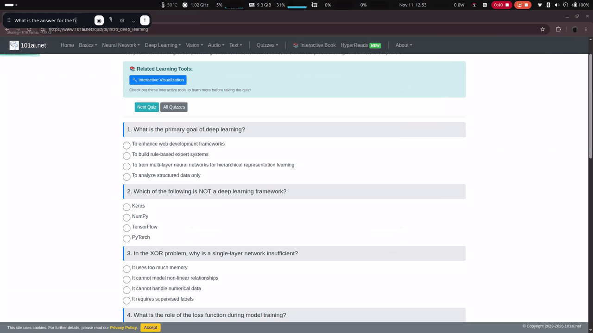
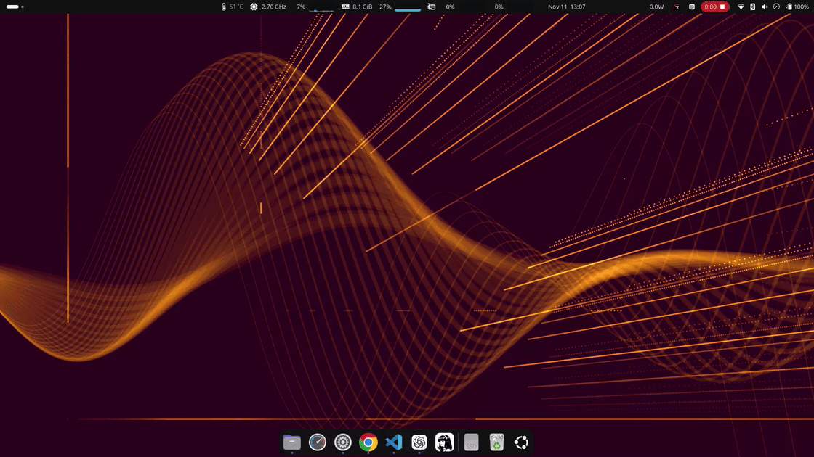

# Optic Chat

Optic Chat is a desktop app that lets you ask an LLM questions about anything you see on your screen.

The main reason I built it is that when I'm learning something new, I don't want AI to do the work for me. I want it to show me how things are done, step by step. I constantly found myself taking screenshots and asking AI questions like "What is this?", "How does this work?", or "How do I do that?"

So, if you've experienced the same frustration, give Optic Chat a try!

[Watch the screen-sharing demo in full resolution](assets/optic-chat-demo-1.mp4)

[Watch the floating window demo in full resolution](assets/optic-chat-demo-2.mp4)

## Requirements:

You can use local LLMs or your Anthropic and OpenAI subscriptions. However, you'll first need to set up a Hermes Agent, as Optic Chat connects to the models through it.

## Get started

- **Linux (GNOME)** — Install [Rust](https://rustup.rs) and run `./run.sh`. The overlay uses OpenGL and X11 or XWayland. Screen sharing needs the ScreenCast portal, PipeWire, and GStreamer with PipeWire and JPEG plugins.
- **Windows** — Native support is unavailable in this version.
- **Connect** — In **Settings → Connection**, use an OpenAI or Anthropic API key, a running LM Studio server, or a ChatGPT/Codex subscription via the local Hermes bridge. Pick a vision-capable model and click **Share** to ask about your screen.

## Providers and shortcuts

Default global keys:
- Ctrl+Super+H: show/hide the app; launches it if closed.
- Ctrl+Super+Space: show/hide the reply.
- Ctrl+Super+Left: move left, keeping vertical position.
- Ctrl+Super+Up: move up, keeping horizontal position.
- Ctrl+Super+Down: move down, keeping horizontal position.
- Ctrl+Super+Right: move right, keeping vertical position.

